

  

    The electrification of transportation, aerospace, and industry demands electric machines and energy conversion systems that are more powerful, more efficient, and more sustainable than anything that exists today. Meeting this challenge requires rethinking the machine, the drive, and the control — together, from first principles.
  

<nav class="rp-jump" aria-label="On this page">
  On this page
  <a href="#themes">Themes</a>
  <a href="#facilities">Facilities</a>
  <a href="#how-we-work">How We Work</a>
  <a href="#applications">Applications</a>
  <a href="#sponsors">Sponsors</a>
</nav>

<!-- ── Research photo slideshow ── -->

  

    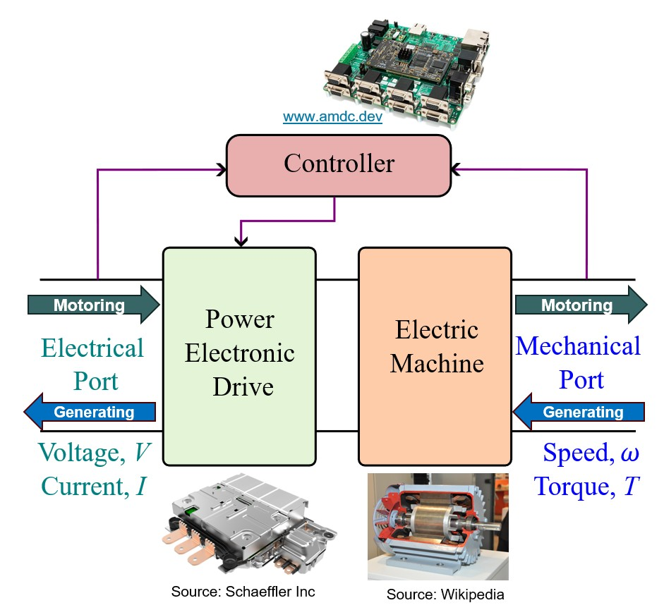
    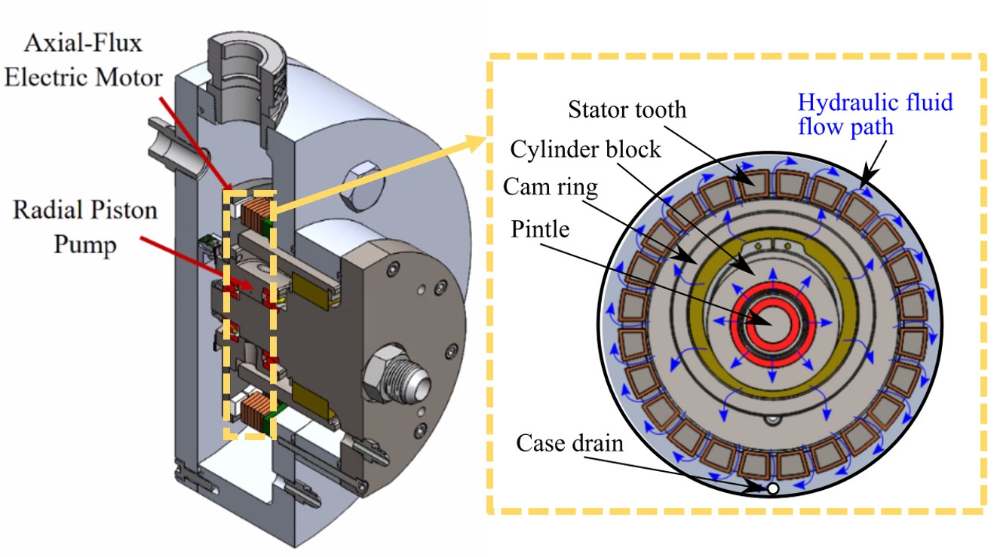
    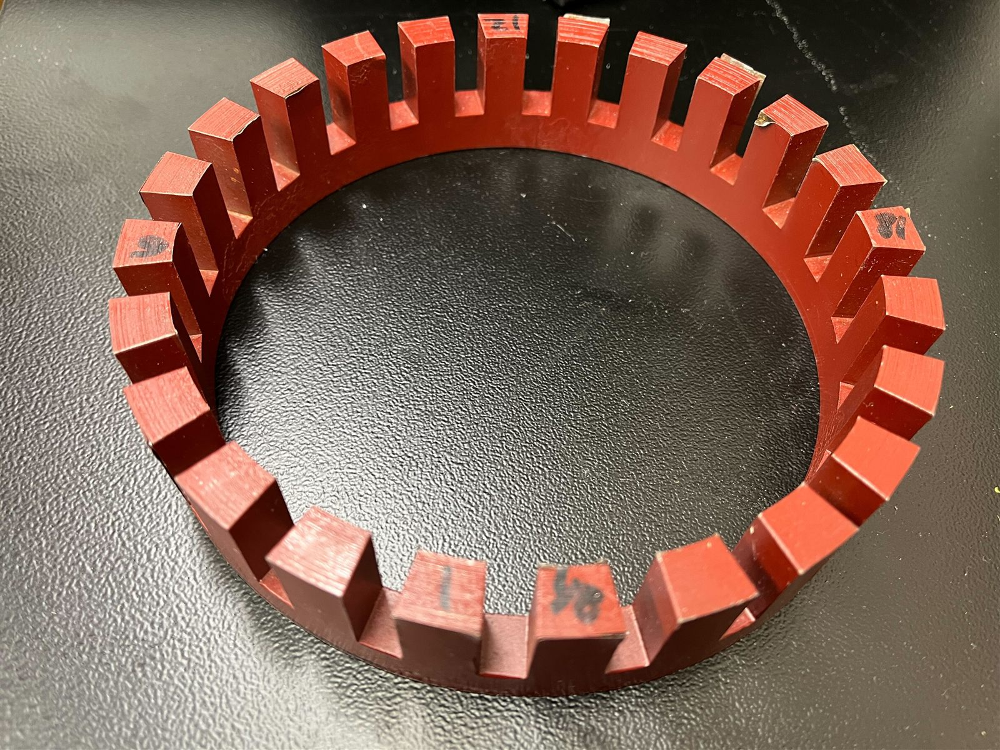
    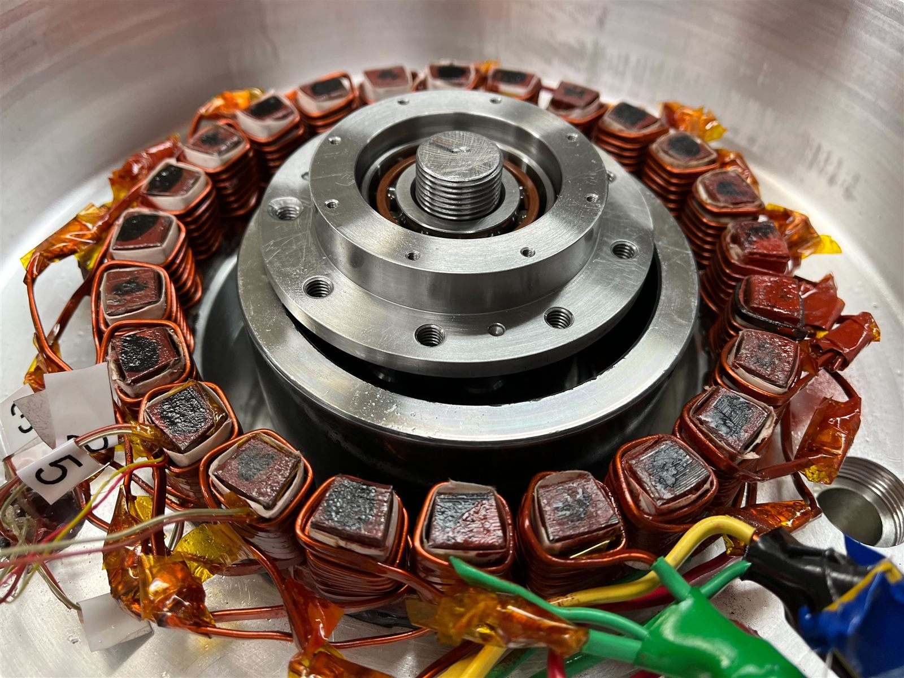
    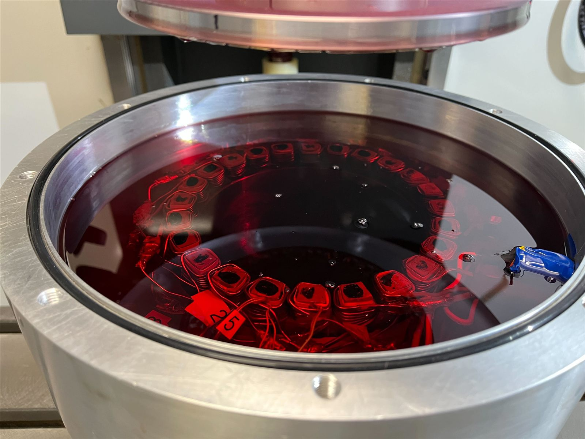
    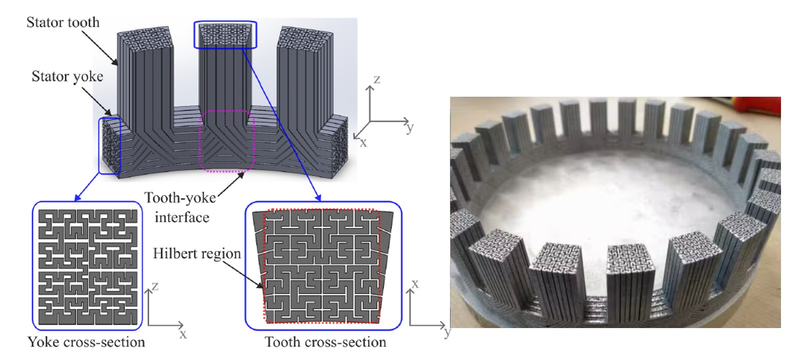
    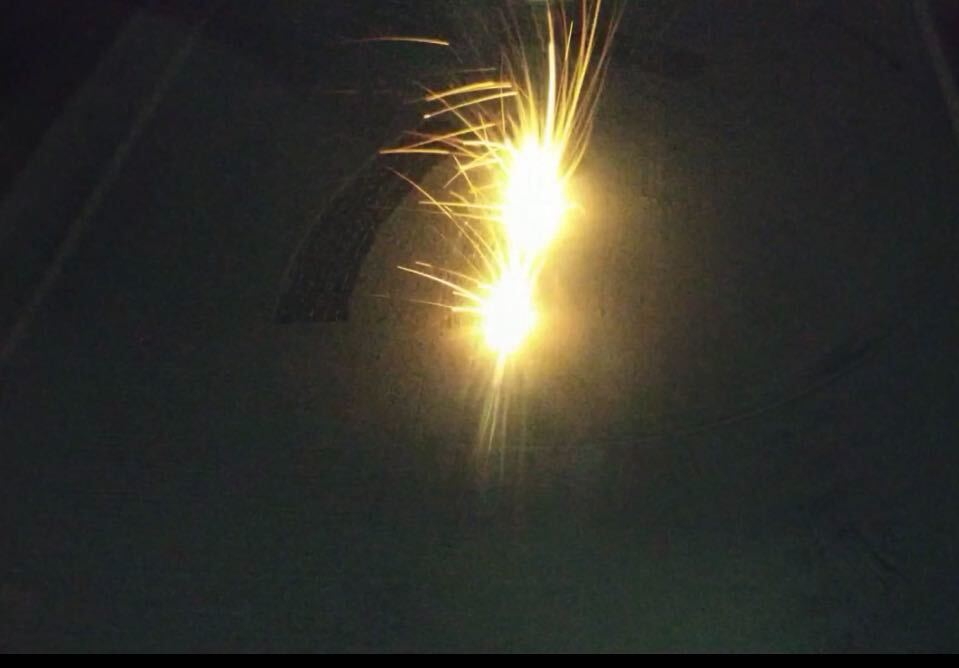
    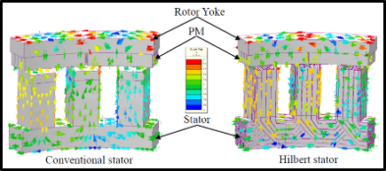
    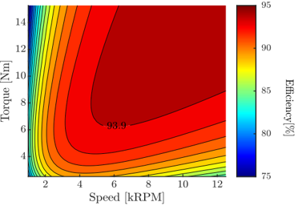
    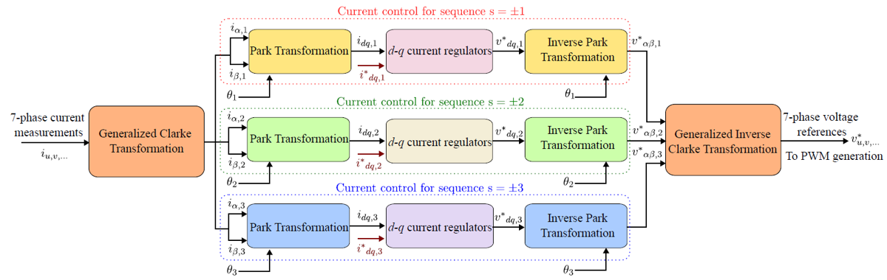
    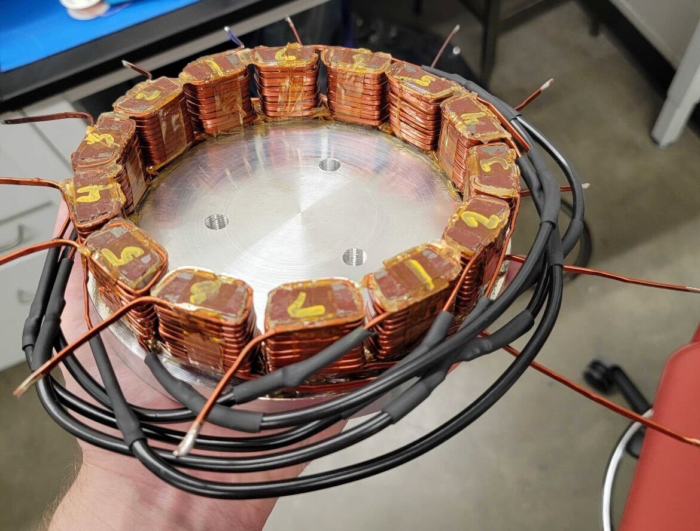
    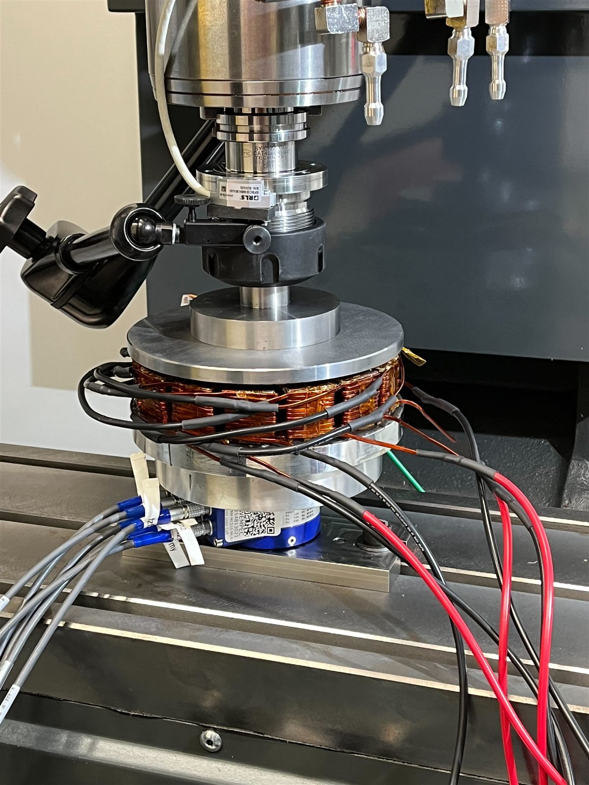
    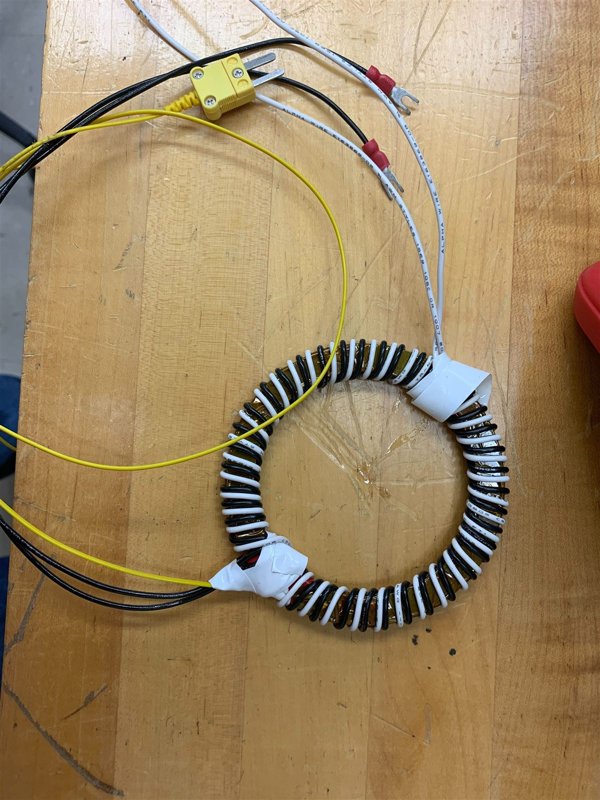
    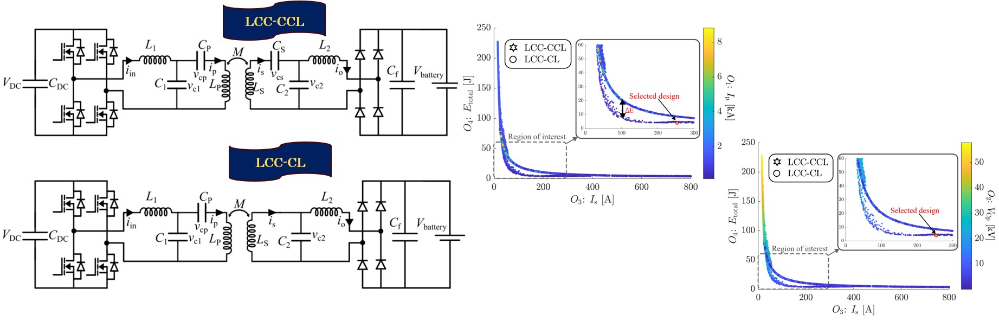
    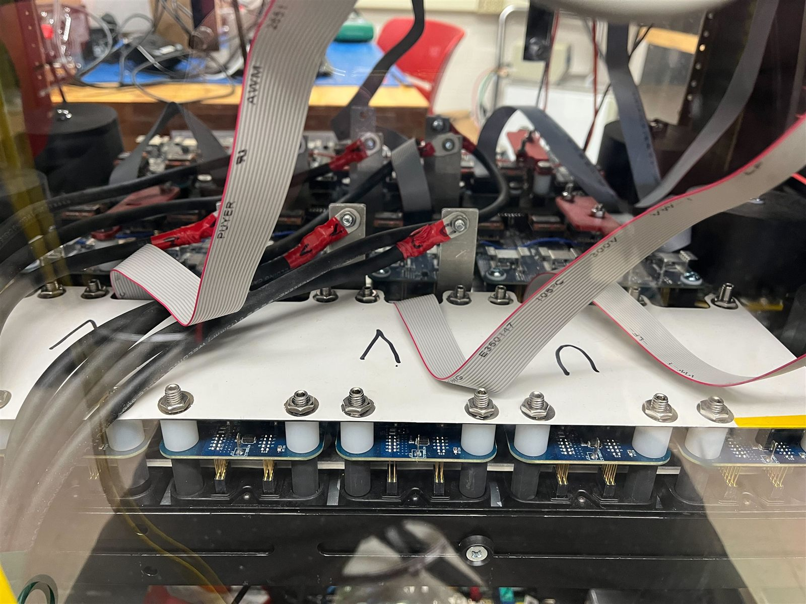

    

      
      
      
      
      
    

  

<!-- ── Research Themes ── -->

  
Research

  
Research Themes

  

   

      
<i class="ti ti-device-desktop-analytics"></i>

      <h3>Integrated Electro-Mechanical Systems</h3>
      
Co-design and optimization of magnetics, power electronics, thermal systems, and mechanical loads.

    

    

      
<i class="ti ti-bulb"></i>

      <h3>Invent New Topologies</h3>
      
Developing unconventional electric machine and power converter topologies for higher performance and lower critical material dependence.

    

    

      
<i class="ti ti-brain"></i>

      <h3>AI-Accelerated Design</h3>
      
Using physics-informed machine learning and optimization to accelerate discovery and improve system performance.

    

    

      
<i class="ti ti-tool"></i>

      <h3>Build the Future</h3>
      
Leveraging advanced manufacturing and novel materials to realize next-generation electro-mechanical systems.

    

    

      
<i class="ti ti-target-arrow"></i>

      <h3>Intelligent Operation</h3>
      
Creating systems that sense, adapt, diagnose, and optimize themselves in real time.

    

  

<!-- ── Facilities ── -->

  
Facilities

  
Built to Build and Test

  
Our lab and campus partners support every step, from simulation to megawatt-scale testing.

  

    
<strong>~1,000 sq ft</strong>of dedicated lab space

    
<strong>6+ workbenches</strong>each with single- and three-phase power

    
<strong>Up to 5 MW</strong>electric machine and drive testing

  

  

    

      

        
<i class="ti ti-activity"></i>

        <h3>Testing &amp; Measurement</h3>
      

      <ul>
        <li>Multi-phase power measurement</li>
        <li>Multi-axis, non-contact dynamometer for linear and rotary machines</li>
        <li>Magnetic materials characterization</li>
        <li>High-power machine and drive testing up to 5 MW at <a href="https://powerpropulsion.nd.edu/facilities-and-capabilities/ignition-park-test-facility/test-cell-1/" target="_blank" rel="noopener">Notre Dame Power and Propulsion</a></li>
      </ul>
    

    

      

        
<i class="ti ti-tool"></i>

        <h3>Prototyping</h3>
      

      <ul>
        <li>Machine shop, 3D printers, and laser cutters at the <a href="https://engineering.nd.edu/departments-programs/engineering-innovation-hub-at-notre-dame/" target="_blank" rel="noopener">Engineering Innovation Hub</a></li>
        <li>In-lab soldering and electronics assembly</li>
        <li>Partnerships with regional manufacturers</li>
      </ul>
    

    

      

        
<i class="ti ti-cpu"></i>

        <h3>Computing</h3>
      

      <ul>
        <li>Dedicated servers with multi-core processors and GPUs</li>
        <li>Engineering software for finite element analysis (FEA) and hardware development</li>
      </ul>
    

  

<!-- ── How We Work / process ── -->

  

    
How We Work

    
From Concept to Hardware

    
We develop technology from first principles through to tested, validated prototypes.

    

      

        
<i class="ti ti-stack-2"></i>

        <h4>Design &amp; Optimize</h4>
        
FEA, analytical models, AI-assisted topology and parameter optimization

      

      

        
<i class="ti ti-tool"></i>

        <h4>Build</h4>
        
Additive manufacturing, winding, assembly, novel materials fabrication

      

      

        
<i class="ti ti-activity"></i>

        <h4>Test &amp; Validate</h4>
        
Dynamometer testing, thermal characterization, HIL, high-speed data acquisition

      

      

        
<i class="ti ti-circle-check"></i>

        <h4>Deploy</h4>
        
Technology transfer, spin-out partnerships, publications, open datasets

      

    

  

<!-- ── Applications spectrum ── -->

  
Applications

  
Across the Power Spectrum

  
Our technologies touch applications from milliwatts to megawatts — anywhere electro-mechanical performance matters.

  

    
<i class="ti ti-heartbeat"></i><h3>Artificial Heart</h3>
Medical

    
<i class="ti ti-cpu"></i><h3>Chip Fabrication</h3>
Semiconductor

    
<i class="ti ti-drone"></i><h3>UAVs &amp; Drones</h3>
Air mobility

    
<i class="ti ti-robot"></i><h3>Robotics</h3>
Automation

    
<i class="ti ti-car"></i><h3>Electric Vehicles</h3>
Transport

    
<i class="ti ti-air-conditioning"></i><h3>HVAC Systems</h3>
Buildings

    
<i class="ti ti-tractor"></i><h3>Off-Highway</h3>
Industrial

    
<i class="ti ti-anchor"></i><h3>Marine Systems</h3>
Maritime

    
<i class="ti ti-wind"></i><h3>Wind Energy</h3>
Renewables

    
<i class="ti ti-rocket"></i><h3>Aerospace</h3>
Aviation &amp; Space

  

<!-- Sponsors (logos shared with the homepage: _includes/sponsors.liquid) -->

  
Sponsors &amp; Partners

  
Thanks to

  

